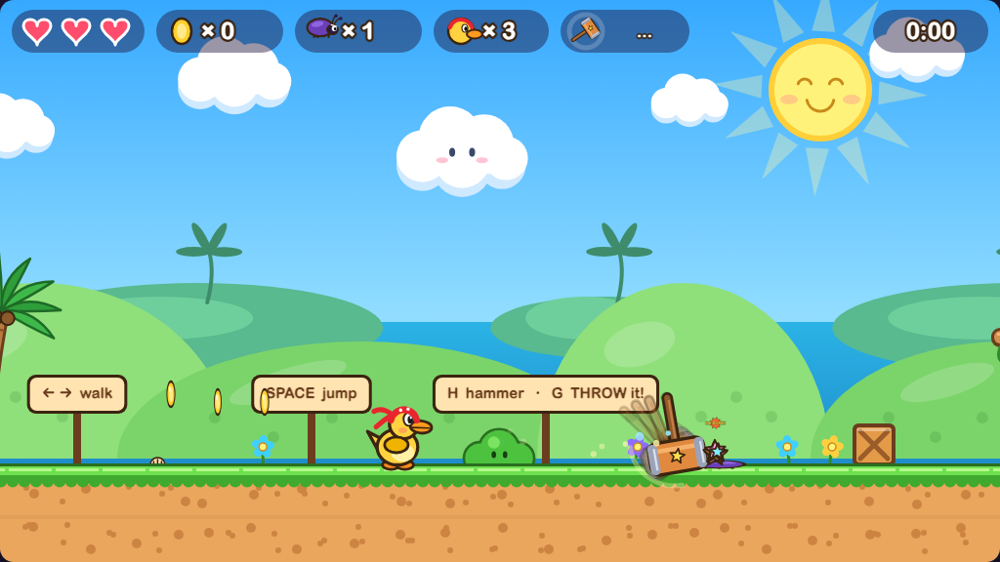
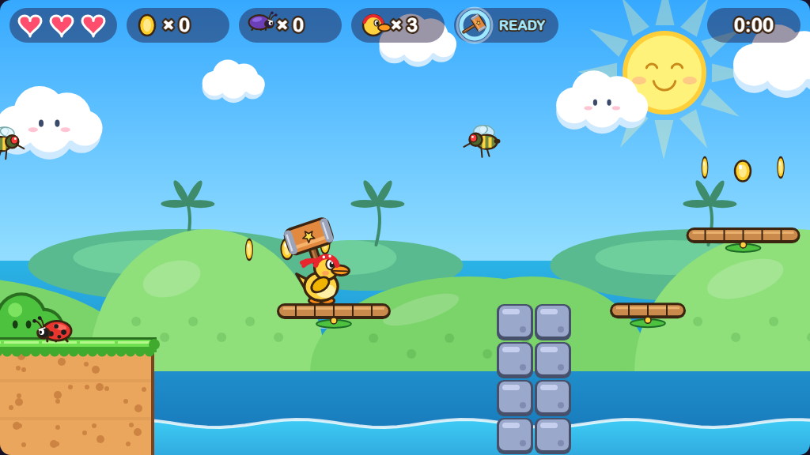
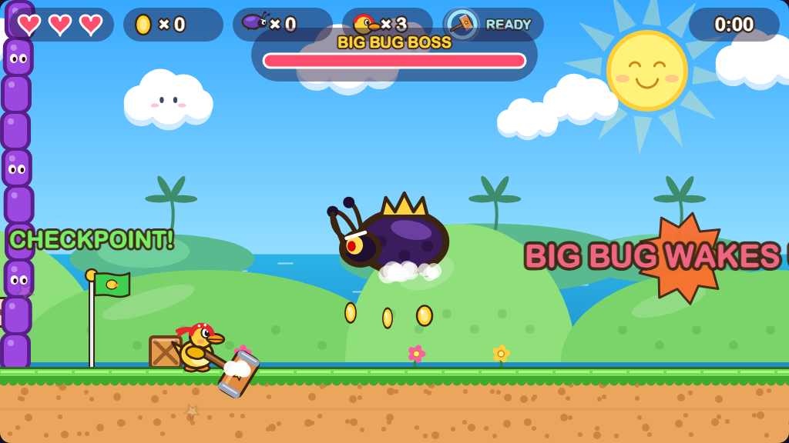
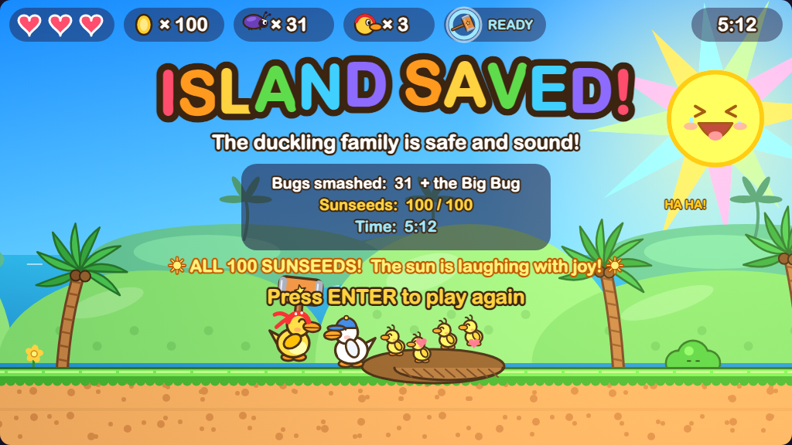

# 🦆🔨 Hammer Duck: Bug Island Rescue

A colorful 2D platformer that runs in the browser. It's a lovely day on Duck Island until the Big Bug crashes in,
stuffs Hammer Duck's whole family into a net and runs off yelling *"You'll NEVER catch me, HAMMER DUCK! Nyah nyah!"*
Grab your huge wooden hammer, smash your way across the island, beat the Big Bug and get your family back!


The whole game is **one HTML file**: no install, no build step, no downloads. All graphics are drawn in code
and all music and sound effects are generated live with the Web Audio API.

## ▶️ How to play

1. Download or clone this repository.
2. Open `index.html` in Safari, Chrome, Firefox or Edge (double-click it).
3. Press **Enter** or **Space** to start. Press **F** (or double-click) to play in full screen.

## 🎮 Controls

| Action | Keyboard | Controller (PlayStation / Xbox) |
|---|---|---|
| Walk | ← → (or A / D) | Left stick / D-pad |
| Jump (hold for higher) | **Space** (also ↑ / W) | ✕ / A |
| Hammer swing | **H** (also X) | ○ / B |
| Hammer **throw** (special) | **G** | □ / X |
| Hammer **slam** (in the air) | **J** or **↓** | △ / Y, or stick down |
| Duck / crouch (on the ground) | **↓** (or S) | Stick down |
| Pause | P / Esc | Start |
| Full screen | F / double-click | — |
| Mute | M | — |

## ✨ Features

- **A silly story intro** where the Big Bug kidnaps the family (press Enter to skip it).
- **A hero duck with a huge hammer:** swing it, slam down from the air, or throw it like a boomerang:
  the thrown hammer spins forward, smashes everything in its path and flies back to her wing.
  The throw is a special move that recharges in 5 seconds (see the meter in the top bar).
- **Bugs:** beetles, fast ladybugs, armored beetles that take two hits (and get *really* fast after the first),
  and wasps that swoop down at you. Duck to dodge them!
- **One long level:** a starting beach, hills, a lagoon with flying rafts, crate fields, stone towers with springs,
  a bug swarm, a boss arena and the home beach.
- **Boss fight** against the crowned Big Bug, with its own dramatic music.
- **100 sunseeds** to collect. Find them all and see what happens to the sun at the end ☀️
- **Lives and hearts:** 3 lives with 3 hearts each. A heart found at full health gives an extra life. Checkpoints along the way.
- **The ending:** the duckling family celebrates with confetti while a calm lullaby plays.
- Works with keyboard and game controllers; adapts to any window size and full screen.







## 🛠️ Development

```
index.html            the whole game (canvas 2D + Web Audio, plain JavaScript)
tools/harness.js      headless Node.js harness that runs the real game code with fake canvas/audio/gamepad
tools/smoke-test.js   regression test: controls, hammer throw, boss, music changes, ending
docs/screenshots/     images used in this README
CLAUDE.md             design notes and conventions (level-building API, agreed game rules, testing workflow)
```

Run the tests (Node.js 18+):

```
node tools/smoke-test.js
```

Debug shortcuts: open `index.html#x=150` to start at column 150 of the level, or `index.html#win` to jump to the ending.

For how the level is built (tiles, helpers, bug types, physics limits) and the design rules agreed so far, see [`CLAUDE.md`](CLAUDE.md).

## 🙌 Credits

Game design by the Stavrovsky family. Built together with [Claude Code](https://claude.com/claude-code).
