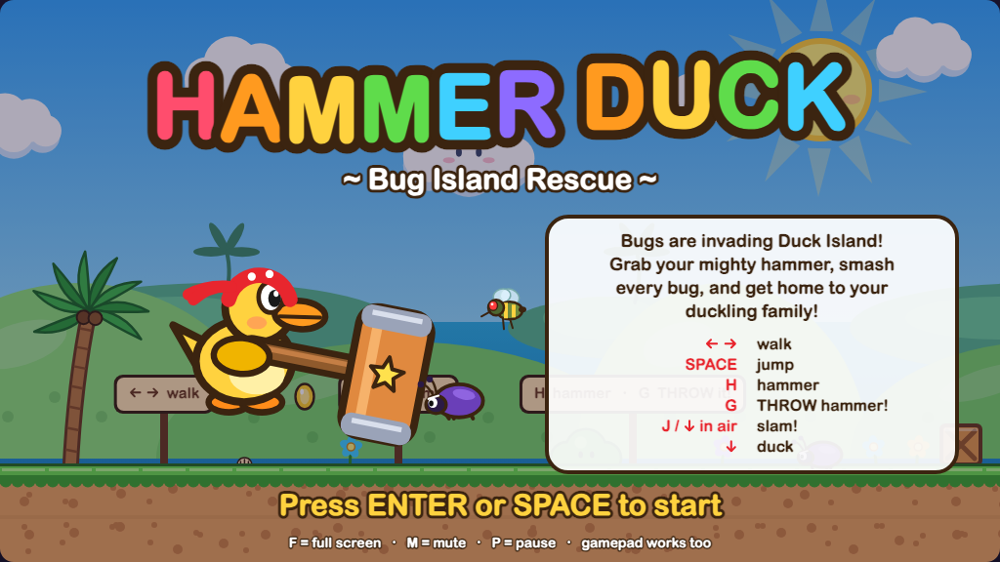
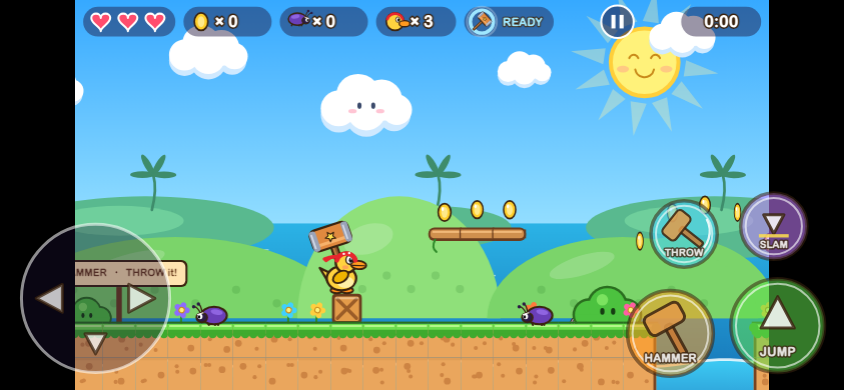
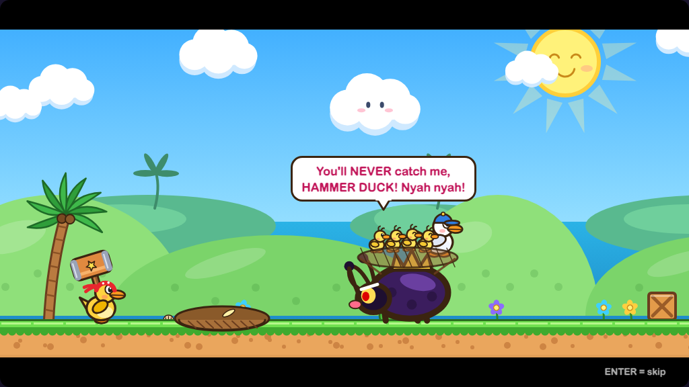
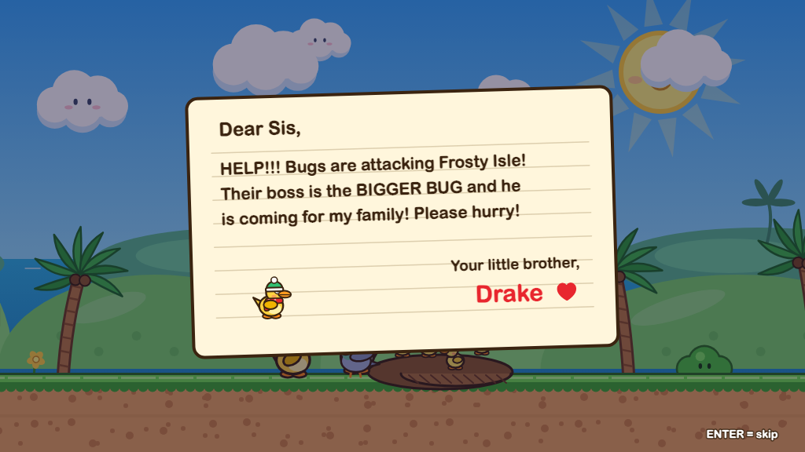
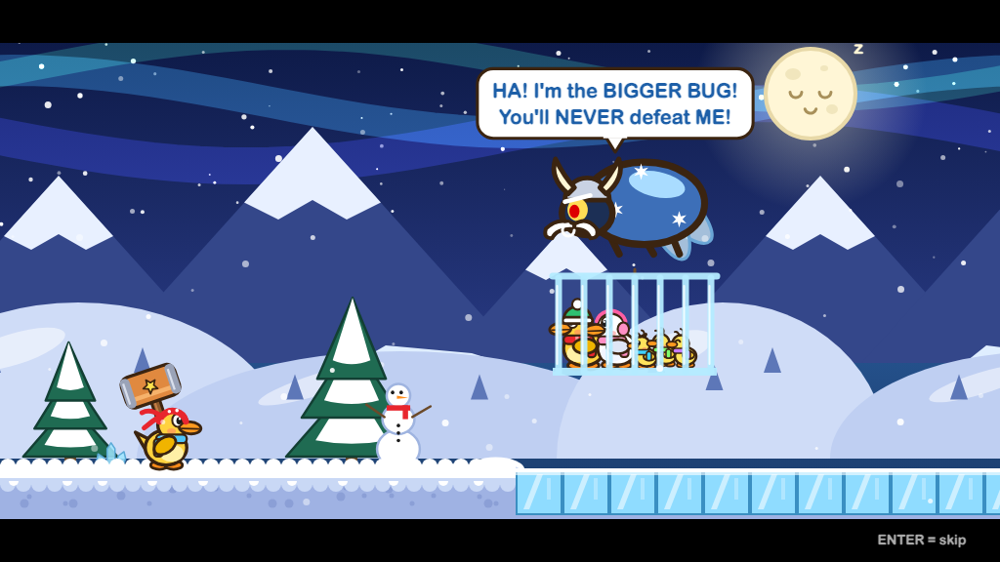
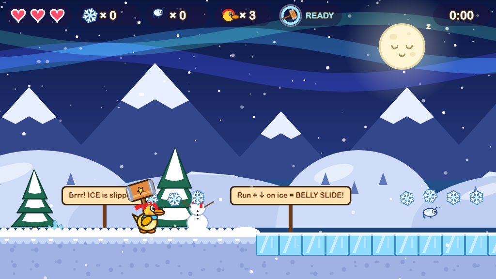
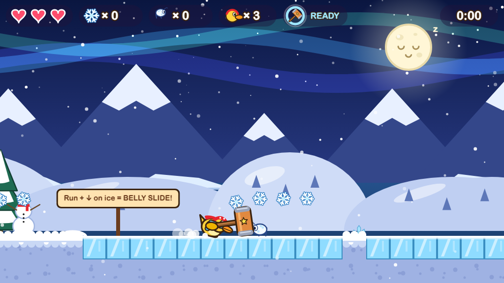
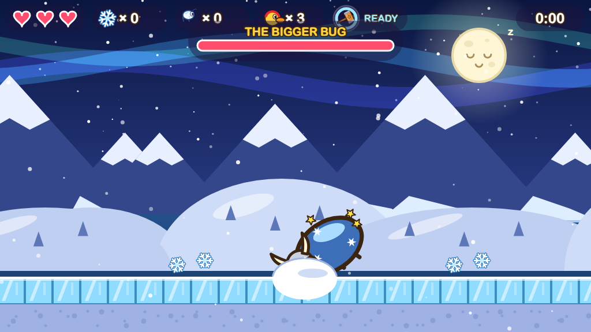
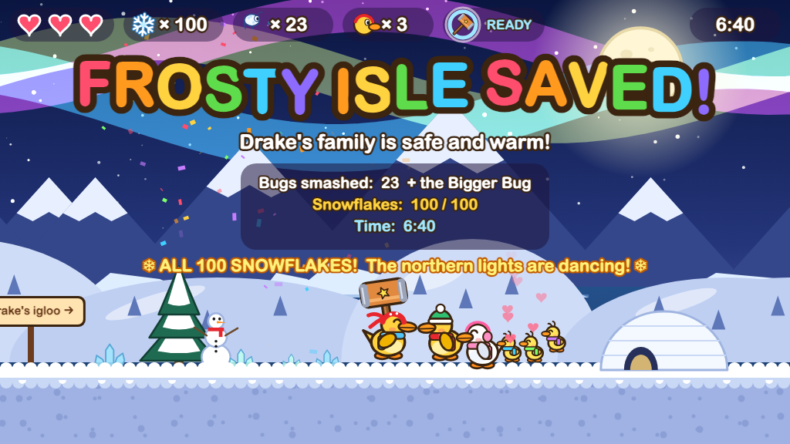

# 🦆🔨 Hammer Duck

A colorful 2D platformer that runs in the browser, with **two worlds**.

**World 1 · Duck Island ☀️:** It's a lovely day until the Big Bug crashes in, stuffs Hammer Duck's whole family
into a net and runs off yelling *"You'll NEVER catch me, HAMMER DUCK! Nyah nyah!"* Grab your huge wooden hammer,
smash your way across the island and get your family back!

**World 2 · Frosty Isle ❄️:** Just as everyone is safe, an emergency pigeon brings a letter from Hammer Duck's
little brother Drake: bugs are attacking his snowy island too! The Big Bug's big brother is waiting:
*"So YOU'RE the duck who beat my little brother? HA! I'm the BIGGER BUG! You'll NEVER defeat ME!"*



No install, no build step, no downloads: just open `index.html`. All graphics are drawn in code
and all music and sound effects are generated live with the Web Audio API.

## ▶️ How to play

1. Download or clone this repository.
2. Open `index.html` in Safari, Chrome, Firefox or Edge (double-click it).
3. Press **Enter** or **Space** to start. Press **F** (or double-click) to play in full screen.
4. After finishing Duck Island once, press **2** on the title screen to fly straight to Frosty Isle.

## 📱 Play on a phone or tablet

Open **https://martinstavrovsky.github.io/hammerduck/** and turn the device sideways. Touch controls appear
as soon as you touch the screen: a d-pad on the left (◀ ▶ walk, ▼ duck / slam) and **JUMP**, **HAMMER**,
**THROW** and **SLAM** buttons on the right. Tap ⏸ for the pause menu (sound on/off, full screen).

- **Android / iPad:** the game goes full screen when you tap to start.
- **iPhone:** Safari doesn't allow full screen for web pages. Tap **Share ⬆ → Add to Home Screen** instead:
  the Hammer Duck icon then opens the game full screen, like an app.



## 🎮 Controls

| Action | Keyboard | Controller (PlayStation / Xbox) |
|---|---|---|
| Walk | ← → (or A / D) | Left stick / D-pad |
| Jump (hold for higher) | **Space** (also ↑ / W) | ✕ / A |
| Hammer swing | **H** (also X) | ○ / B |
| Hammer **throw** (special) | **G** | □ / X |
| Hammer **slam** (in the air) | **J** or **↓** | △ / Y, or stick down |
| Duck / crouch (on the ground) | **↓** (or S) | Stick down |
| **Belly slide** (on ice) | run, then hold **↓** | run, then stick down |
| Next line in a cutscene | **Space** or H (touch: tap) | ✕ / A or ○ / B |
| Skip a whole cutscene | Enter / Esc (touch: SKIP) | Start |
| Pause | P / Esc | Start |
| Full screen | F / double-click | — |
| Mute | M | — |

## ✨ Features

**Hammer Duck and her hammer:** swing it, slam down from the air, or throw it like a boomerang. The thrown hammer
spins forward, smashes everything in its path and flies back to her wing. The throw is a special move that recharges
in 5 seconds (see the meter in the top bar). 3 lives with 3 hearts each; a heart found at full health gives an extra life.

### ☀️ World 1: Duck Island
- Beaches, hills, a lagoon with flying rafts, crate fields, stone towers with springs and a bug swarm.
- Beetles, fast ladybugs, armored beetles that take two hits (and get *really* fast after the first),
  and wasps that swoop down at you. Duck to dodge them!
- **Boss:** the crowned Big Bug, who charges and jumps at you.
- 100 sunseeds to collect. Find them all and see what happens to the sun ☀️

### ❄️ World 2: Frosty Isle
- A snowy night island with northern lights, a sleepy moon, pine trees, snowmen and igloos.
- **New tricks:** slippery ice and the belly slide, ice floes that sink under your feet, cracking ice bridges,
  steam geysers that blast you up cliffs, wind gusts that push you back (crouch to brace!) and falling icicles.
- **New bugs:** snow fleas that hop at you, ice spiders that drop down on threads, frost moths that throw snowballs
  (bat them back with the hammer: *return to sender!*) and roly-polys that curl up and roll at you.
- **Boss:** the Bigger Bug, with a viking helmet and a magnificent mustache. He flies and drops snow bombs. Only a
  thrown hammer (or a batted-back bomb) reaches him in the air, but when he dives and gets his head stuck in the
  snow, smash away! Twice as tough as his little brother, and he gets angrier at half health.
- 100 snowflakes to collect. Find them all and see what the northern lights do ❄️
- **The ending:** smash the ice cage, and Drake's family thanks you: *"THANK YOU, SIS!"*

Each world has its own music: an island tune, a dramatic boss theme, a victory march and a lullaby on Duck Island;
a twinkly waltz, a galloping boss theme, a sleigh-bell march and a music-box lullaby on Frosty Isle.











## 🛠️ Development

Plain JavaScript files loaded by `index.html` with ordinary `<script>` tags, so it still works by double-clicking
(no web server, no bundler).

```
index.html            canvas + the list of scripts, in load order
src/engine.js         shared engine: physics, the duck & hammer, enemy framework, HUD, screens, main loop
worlds/island.js      World 1: level, art, bugs, Big Bug boss, music, kidnapping intro, family ending
worlds/frost.js       World 2: level, art, ice mechanics, bugs, Bigger Bug boss, music, intro, Drake's ending
src/story.js          the pigeon scene between the worlds
src/main.js           boot + debug shortcuts
tools/harness.js      headless Node.js harness that runs the real game scripts with fake canvas/audio/gamepad
tools/smoke-test.js   World 1 regression test (controls, throw, boss, music, intro, ending)
tools/world2-test.js  World 2 mechanics test (ice, slide, floes, geysers, wind, icicles, bugs, boss, story)
docs/screenshots/     images used in this README
CLAUDE.md             design notes and conventions (world API, level-building helpers, agreed rules, testing)
```

Run the tests (Node.js 18+):

```
node tools/smoke-test.js
node tools/world2-test.js
```

Debug shortcuts: `index.html#x=150` starts World 1 at column 150, `index.html#w=2&x=80` starts World 2 at column 80,
and `#win` (or `#w=2&win`) jumps to a world's ending.

For how worlds and levels are built and the design rules agreed so far, see [`CLAUDE.md`](CLAUDE.md).

## 🙌 Credits

Game design by the Stavrovsky family. Built together with [Claude Code](https://claude.com/claude-code).
